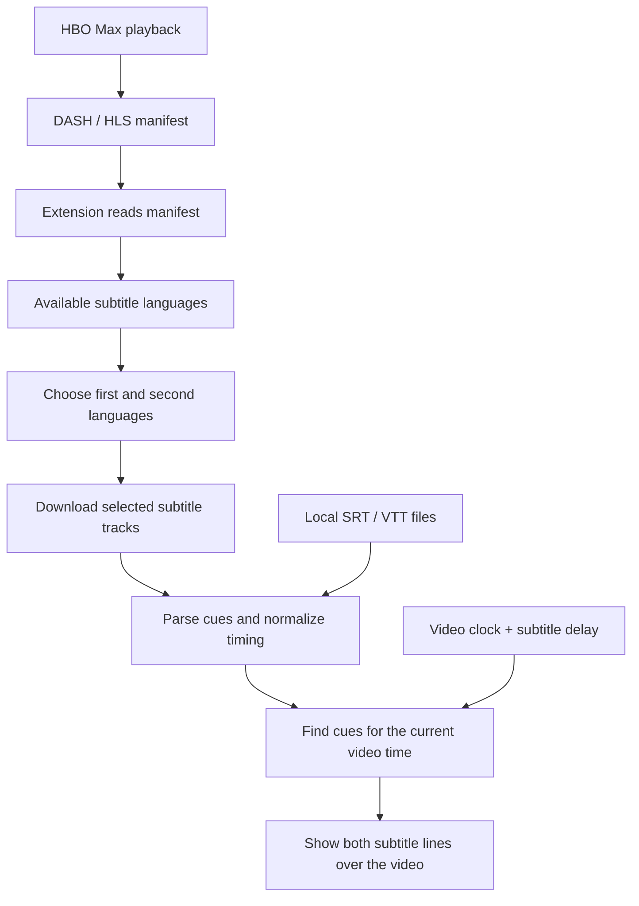

# HBO Max Dual Subtitles for Firefox & Zen

Watch HBO Max with two subtitle languages at once in Zen or Firefox.

Choose official subtitle tracks, or add your own SRT/VTT files. No translation service, dependencies, or build step.

## Install

1. Download this repository using **Code → Download ZIP** and extract it, or clone it:

   ```sh
   git clone https://github.com/nonnnz/hbo-max-dual-subtitles.git
   ```

2. Open `about:debugging#/runtime/this-firefox` in Zen or Firefox.
3. Click **Load Temporary Add-on…** and select `extension/manifest.json`.
4. Reload your HBO Max video and open **Dual Subtitles** at the top right.
5. Choose your first and second languages. Turn HBO Max's native captions off if the extension renders both lines.

Requires a Firefox-based desktop browser, version 115 or newer, and access to HBO Max. Temporary add-ons must be loaded again after restarting the browser. Permanent installation requires a Mozilla-signed add-on; this project is currently unsigned.

**Updating:** click **Reload** beside the extension on the debugging page, then reload your HBO Max tab.

## Use

- **Two official languages:** choose both tracks in the extension panel.
- **Native captions plus a second language:** keep **First language** set to **Off / HBO Max captions**, choose your first language in HBO Max, and select the second in the extension.
- **Your own subtitles:** add a `.srt` or `.vtt` file. Load two files to use a local pair.
- **Timing:** positive **Subtitle delay** displays subtitles later.
- **Placement:** adjust **Height above bottom** to clear the player controls.
- **Missing languages:** click **Detect subtitles again**. If the panel has no manifest, reload the playback tab with the extension enabled.

Subtitles follow pauses and seeking. Tracks clear when navigating to another title. Files and preferences are not saved.

## How it works

The extension reads HBO Max's playback manifest to discover subtitle languages, then downloads the tracks you select. You can also load local subtitle files. Cue timing follows the video clock, so pausing and seeking keep the subtitles in sync.



HBO Max continues to play the video. If you keep its native captions enabled, the extension can display just the second language above them. Local subtitle files stay on your device.

## Compatibility

Reported working on HBO Max in Zen by the project owner. Automated browser checks cover Thai/English discovery, selection, rendering, seeking, and navigation with synthetic playback data. Other titles, regions, and browser versions may behave differently.

The extension supports HBO Max's segmented DASH WebVTT tracks, direct WebVTT/SRT files, and finite HLS WebVTT playlists. It resolves DASH segment templates, repeated segments, and multiple periods, and loads only selected languages. Language availability depends on the title and region; the extension does not generate or translate subtitles.

Current limits:

- DASH SegmentList/SegmentBase, TTML, binary/encrypted subtitles, live playlists, and subtitle URLs needing extra authorization are unsupported.
- Browser-native tracks may expose cues only for selected languages.
- Fullscreen works when HBO Max uses a player container. Picture-in-picture and fullscreen of the video element alone cannot show the overlay.

## Privacy and permissions

Everything is processed locally. Local subtitle files are never uploaded. The extension has no analytics or translation service and does not bypass DRM.

HTTPS host access lets the extension read subtitle files from HBO Max's separate CDN domains. Content scripts run only on HBO Max / Max pages. The request observer checks that requests originate from those sites, reads only matching DASH/HLS manifests, passes playback bytes through unchanged, and keeps at most eight manifests per tab in memory. Selected subtitle files are fetched from their original CDN without cookies.

## Development

```sh
node tests/check.cjs
```

Use Node.js 24 or newer. See [CONTRIBUTING.md](CONTRIBUTING.md) for browser checks, local development, and packaging. GitHub Actions runs the Node checks and creates an unsigned ZIP artifact; browser playback checks are manual.

See [CHANGELOG.md](CHANGELOG.md) for version history. Bugs and feature requests are welcome through the repository's issue templates. Remove account details and signed URLs from reports.

## Credits and license

The DASH/WebVTT approach and timing cases were cross-checked against [MultiSub](https://github.com/MultiSub/MultiSub) and [DuetSub's public HBO Max sample](https://github.com/semantic-craft/duetsub/blob/main/research/findings/site-samples/hbomax-capture.json). This extension uses Firefox response filtering for discovery.

[MIT License](LICENSE). Not affiliated with HBO Max, Warner Bros. Discovery, Mozilla, or Zen Browser.
